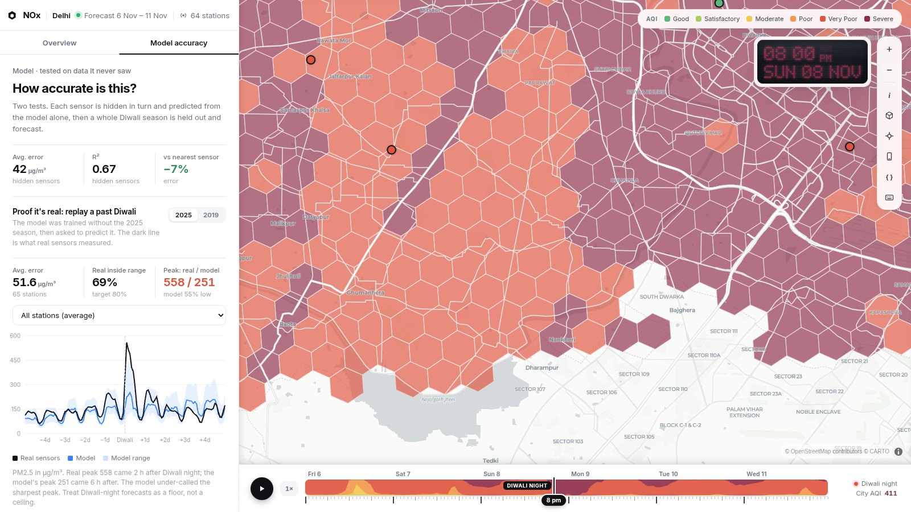
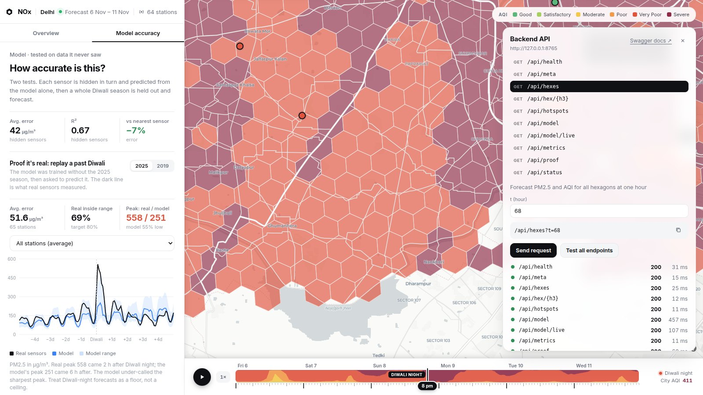
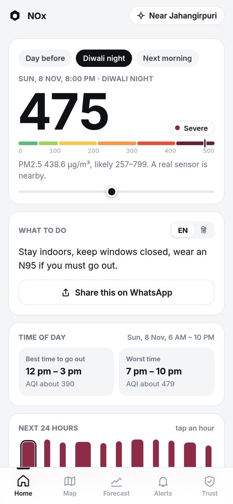
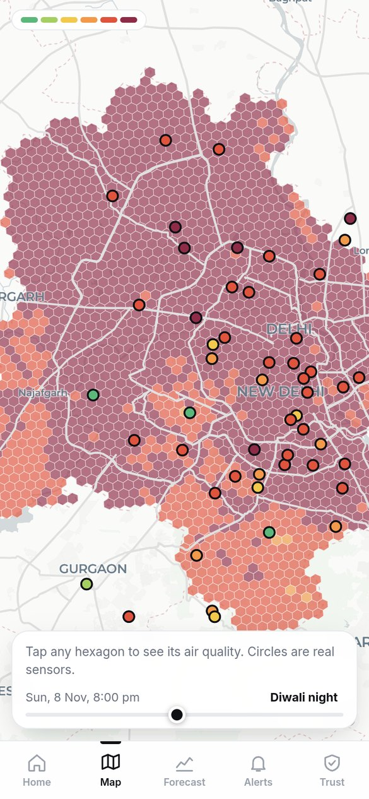
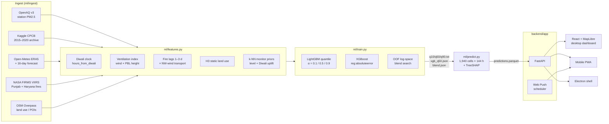

<div align="center">

# NOₓ

### Hyperlocal, sensor-free PM2.5 forecasting for Diwali

**🏆 Winner: CodeAccess Overnight Hackathon, Thapar Institute of Engineering and Technology**

Probabilistic, hex-gridded PM2.5 forecasts for every ~0.7 km² of Delhi, hour by hour, including the places with no air monitor.


<sub>Diwali night (8 Nov 2026, 8 PM IST) in 3D mode. Column height and colour show the forecast AQI for each H3 cell. The circles are real CPCB/DPCC monitors, coloured by their latest reading.</sub>

</div>

---

## TL;DR

Delhi has about 40 regulatory air monitors for roughly 1,500 km². Most of the city, and almost all of rural India, has no measured air quality at all.

NOₓ fixes that by changing the input. The model never interpolates live sensor readings. It learns PM2.5 from **conditions**: meteorology, boundary-layer ventilation, upwind crop-residue fire activity, the Diwali clock and land use from OpenStreetMap. Every one of those inputs exists for any point on the map, so the model can produce a forecast for an area with no monitor.

| | |
|---|---|
| **Spatial unit** | Uber H3 resolution 8 (~0.74 km² hexagons), **1,940 cells** covering NCT Delhi |
| **Temporal unit** | Hourly, **144-hour horizon** (6–11 Nov 2026, Diwali −2 d → +3 d) |
| **Output** | PM2.5 (µg/m³) as a **P10 / P50 / P90** band, converted to Indian AQI, with a 4-way source attribution |
| **Forecast size** | 1,940 × 144 = **279,360** cell-hours per run |
| **Training data** | **836,036** station-hours · **101** stations · **12** post-monsoon seasons (2015–2026) |
| **Model** | LightGBM quantile ensemble (P10/P50/P90) + XGBoost L1 median, blended in log space. **1,600 trees, 34 features** |
| **Hide-a-station MAE** | **42.0 µg/m³** (R² 0.67) vs 45.3 copy-nearest-sensor vs 59.9 for the CAMS global model |
| **Runs on** | One laptop CPU. No GPU, no cloud, no paid APIs |

---

## Contents

- [Screenshots](#screenshots)
- [System architecture](#system-architecture)
- [Data pipeline](#data-pipeline)
- [Feature engineering](#feature-engineering)
- [Model](#model)
- [Evaluation](#evaluation)
- [Serving layer](#serving-layer)
- [Frontend](#frontend)
- [Verifiability](#verifiability)
- [Quickstart](#quickstart)
- [Engineering notes](#engineering-notes-bugs-worth-knowing-about)
- [Known limitations](#known-limitations)
- [Repository layout](#repository-layout)

---

## Screenshots

### City view: forecast field on Diwali night

Every hexagon is a model output. The circles are real monitors, coloured by their latest real reading; click one to open its public OpenAQ page. The sidebar shows the city-wide P10–P90 envelope over the 144-hour window, and the footer is a scrubbable timeline with a heat strip of city AQI.

### Area drill-down: a cell 6 km from the nearest sensor

Click a cell to see its PM2.5, the P10–P90 AQI range, the distance to the nearest real monitor, a 6-day forecast with its uncertainty band, and a SHAP-based breakdown of what is driving the estimate (crackers, farm-fire smoke, weather and trapped air, local sources).

### Model accuracy: replay of a Diwali the model never saw

For this replay the model was retrained **without the 2025 season** and then asked to forecast it. Black is what the sensors measured, blue is the model, and the shaded band is P10–P90. The site states plainly that the model under-calls the sharpest Diwali-night peak.

### Built-in API console

Press <kbd>A</kbd>. It lists every endpoint, sends live requests, shows status, latency and payload, copies requests as `curl`, and has a one-click "Test all endpoints" smoke test.

### Mobile PWA
<p align="center">
  
  &nbsp;&nbsp;
  
</p>

Viewports of 860 px or less get a separate mobile-first app. It has a per-area AQI with uncertainty, advice in English and Hindi, best and worst time to go outside, a 24-hour strip, WhatsApp sharing, Web Push alerts and deep links (`/?area=<h3>&t=<hour>&tab=…`).

---

## System architecture



Everything runs as a single process. FastAPI serves both the JSON API and the compiled Vite bundle, so `./nox run` starts the whole system.

---

## Data pipeline

All data is real and comes from public sources. There is **no mock or placeholder data** anywhere in the stack. If the model hasn't been built, the API returns `503` and the UI shows a live build-progress screen instead.

| Source | What | Notes |
|---|---|---|
| **OpenAQ v3** | Hourly PM2.5 from CPCB / DPCC / IMD stations, 2022 onward | Rate-limited to 60 req/min, which is the main cost of a full build |
| **Kaggle *Air Quality Data in India*** | `station_hour.csv`, ~893k Delhi readings, 2015–2020 | Has no coordinates, so stations are joined to OpenAQ locations **by name** |
| **Open-Meteo (ERA5 reanalysis + forecast)** | Temperature, RH, 10 m wind, precipitation, surface pressure, **boundary-layer height** | 9-point grid over Delhi; 16-day forecast horizon |
| **NASA FIRMS (VIIRS)** | Active-fire detections in a Punjab + Haryana bounding box | 721k detections 2015–2026; the API allows **at most 5 days per request** |
| **OpenStreetMap (Overpass)** | Roads, industrial / green / residential land use, schools, hospitals, markets | Aggregated per H3 cell |

`ml/pipeline.py` orchestrates the steps with caching, so finished steps are skipped and `./nox run` is idempotent. The small build artefacts (model files, forecast parquet, proof bundle, grid, ~17 MB) are committed so that a fresh clone serves the site immediately without retraining.

---

## Feature engineering

**34 features** per (location, hour), defined in [`ml/features.py`](ml/features.py). The same builder is used for training, batch forecasting and live inference, so training and serving cannot drift apart.

| Group | Features | Why |
|---|---|---|
| **Temporal** | `hour_sin`, `hour_cos`, `dow` | Diurnal and weekly emission and dispersion cycles |
| **Diwali clock** | `hours_from_diwali` (clipped to −72…+120), `cracker_window` (−2 h…+14 h) | Encodes the festival as a time offset, not a calendar date, so the model **can't memorise which year** a sample came from |
| **Meteorology** | T, RH, wind speed, precipitation, PBL height, surface pressure, `wind_u`, `wind_v` | Dispersion physics |
| **Ventilation** | `ventilation` = wind speed × boundary-layer height, `nw_wind` flag | The ventilation coefficient: low values mean pollutants stay trapped near the ground |
| **Transboundary smoke** | `fire_lag1..3`, `fire_3d`, `stubble_transport` (fire × NW wind) | Crop-residue fires in Punjab and Haryana are upwind of Delhi under NW flow, with a 1–3 day transport lag |
| **Land use (static, per H3 cell)** | Major / all road km, road density, industrial / green / residential fraction, # schools / hospitals / markets | Local sources and sinks; road density stands in for traffic |
| **Location** | `lat`, `lon` | Residual spatial structure |
| **Monitor priors** | `dist_monitor_km`, `nbr_level`, `nbr_diwali_uplift` | Inverse-distance blend of the **historical** long-run level and Diwali uplift of the k = 3 nearest monitors. During training a station only sees *other* stations (`exclude_self=True`), the same view a hexagon far from any monitor gets |

The monitor priors are fixed per-station statistics, not live readings. **Inference never uses a real-time sensor value.**

---

## Model

### Architecture

```
                     ┌─────────────────────────────┐
  X (34 features) ──▶│ LightGBM quantile  α = 0.10 │──▶ P10
                     │ LightGBM quantile  α = 0.50 │──┐
                     │ LightGBM quantile  α = 0.90 │──┼─▶ P90
                     └─────────────────────────────┘  │
                     ┌─────────────────────────────┐  │  log-space blend
  X ────────────────▶│ XGBoost  reg:absoluteerror  │──┴─▶ w·log1p(LGB) + (1−w)·log1p(XGB)
                     └─────────────────────────────┘           │
                                                    clip into [P10, P90] ─▶ P50
```

- **Target:** `log1p(PM2.5)`. PM2.5 is heavy-tailed (Diwali night can reach 10× the seasonal baseline), so the model is trained in log space and outputs are mapped back with `expm1`.
- **LightGBM:** three quantile regressors (pinball loss at α = 0.1 / 0.5 / 0.9). 400 trees each, `num_leaves=48`, `lr=0.06`, `min_child_samples=60`, row and column subsampling at 0.8.
- **XGBoost:** a second model family for the median. L1 objective, `hist` tree method, `max_depth=8`, 400 trees.
- **Hybrid median:** the blend weight is chosen by grid search on **out-of-fold hide-a-station predictions**, so the weight is tuned on stations the models never saw. The current weights are **0.15 LightGBM / 0.85 XGBoost** ([`ml/models/blend.json`](ml/models/blend.json)). The blended median is then clipped into the LightGBM [P10, P90] band so the quantiles can't cross.
- **Source attribution:** TreeSHAP (`pred_contrib=True`) on the P50 LightGBM model. Contributions are summed within 4 semantic groups (**Crackers**, **Farm-fire smoke**, **Weather & trapped air**, **Local sources**), and only the positive pushes are kept and shown as shares.
- **Total:** 1,200 LightGBM + 400 XGBoost = **1,600 trees**.

### What drives it (top gain importances, P50)

| Feature | Gain share |
|---|---|
| `hours_from_diwali` | 24.5% |
| `fire_lag1` | 9.3% |
| `fire_3d` | 9.1% |
| `fire_lag3` | 7.7% |
| `temperature_2m` | 7.6% |
| `ventilation` | 5.1% |

The two biggest signals the model found are the Diwali clock and lagged upwind farm fires.

---

## Evaluation

There are three separate test protocols. All the numbers below come from [`ml/models/metrics.json`](ml/models/metrics.json) and [`ml/data/processed/proof.json`](ml/data/processed/proof.json), and the app shows the same numbers in its *Model accuracy* tab.

### 1. Hide-a-station (spatial generalisation)

5-fold **`GroupKFold` grouped by station**: every fold holds out whole monitors, and the model has to predict them from conditions alone. This is the test of the "works where there is no sensor" claim.

| Method | MAE (µg/m³) | RMSE | R² | AQI-category acc. |
|---|---:|---:|---:|---:|
| **NOₓ hybrid** | **42.0** | **72.0** | **0.671** | **58.1%** |
| LightGBM only | 43.0 | 73.5 | 0.656 | 57.5% |
| XGBoost only | 42.1 | 72.0 | 0.670 | 58.0% |
| Copy nearest real sensor (same hour) | 45.3 | 83.0 | 0.563 | 57.5% |

Against the **CAMS global atmospheric model** (ECMWF Copernicus), on the 271,856 rows where CAMS is available:

| Method | MAE | R² |
|---|---:|---:|
| **NOₓ** | **36.4** | **0.662** |
| CAMS global | 59.9 | 0.207 |

That is about **39% lower error than CAMS**. The "copy nearest sensor" baseline is an *oracle*: it reads the real same-hour value from a neighbouring station, which no forecast can do. NOₓ still beats it, and does so without any live readings.

**Error by Diwali phase:** before 24.6 · during 82.9 · after 54.1 µg/m³ MAE. Diwali night is the hardest part to predict.

### 2. Held-out Diwali season (temporal generalisation)

The model is retrained with one entire season removed and evaluated on Diwali ±4 days of that season:

| Season | MAE | R² | P95 real / model |
|---|---:|---:|---:|
| 2017 | 76.0 | 0.21 | 389 / 396 |
| 2019 | 68.6 | 0.36 | 419 / 711 |
| 2025 | 52.4 | 0.28 | 335 / 431 |

### 3. Full replay (shown in the app)

`ml/proof.py` retrains without a season and replays ±5 days against every station, both per station and as a city average:

| Season | Stations | MAE | Real inside P10–P90 | Real peak / model peak |
|---|---:|---:|---:|---:|
| 2025 | 65 | 51.6 | 69% | 558 / 251 |
| 2019 | 66 | 73.0 | 68% | 600 / 493 |

**How to read these results:** the model clearly beats the global physics model and edges out the oracle nearest-sensor baseline. It **under-calls the sharpest Diwali-night spike**, so the forecast peak should be read as a floor, not a ceiling. The UI says this next to the chart.

---

## Serving layer

FastAPI ([`backend/app/main.py`](backend/app/main.py)). The forecast parquet is loaded into memory once and every endpoint is a vectorised slice of it. Swagger is at `/docs`.

| Endpoint | Returns |
|---|---|
| `GET /api/health` | Liveness, readiness, cell count, forecast file age |
| `GET /api/meta` | City, window, Diwali hour, stations with latest real reading + OpenAQ link |
| `GET /api/hexes?t=` | PM2.5 / AQI / distance-to-sensor for all 1,940 cells at hour `t` |
| `GET /api/hex/{h3}?t=` | P10–P90 range, 144-h series, SHAP drivers, advice, alert text (EN/HI) |
| `GET /api/hotspots?t=` | Worst-hit cells, reverse-labelled to the nearest locality |
| `GET /api/model` | Model card: architecture, hyperparameters, file hashes, host CPU/RAM, data freshness |
| `GET /api/model/live?h3=&t=` | **Live inference**: builds the 34-feature row on the server, runs all models, returns per-feature SHAP pushes, wall-clock latency and whether the result matches the stored forecast |
| `GET /api/metrics` | Full evaluation report |
| `GET /api/proof` | Replay series, latest readings, SHA-256 fingerprints |
| `GET /api/status` | Pipeline progress (drives the build screen) |
| `GET /api/connect` | LAN URL + QR payload for opening on a phone |
| `/api/push/{key,preview,subscribe,unsubscribe,send}` | Web Push (VAPID) subscription management |

**Push scheduler:** a background thread checks the wall clock every minute and sends three rule-based alerts: a day-before summary, a heads-up 3 h before an area's forecast first crosses *Very Poor*, and *Severe now*. Alerts are in English or Hindi and deep-link to the area.

Time axis: `t` is the hour offset from 6 Nov 2026 00:00 IST. Diwali night (20:00 IST) is `t = 68`.

---

## Frontend

React 19 + TypeScript + Vite 8, in [`frontend/`](frontend/).

- **MapLibre GL 6** on a key-free Carto Positron basemap. Hexagon polygons come from `h3-js` on the client, so the API only sends cell IDs and values.
- **3D mode** (<kbd>3</kbd>): a `fill-extrusion` layer with height = AQI × 9 m and a vertical gradient, plus an animated camera pitch to 52° and bearing to −18°.
- **Timeline:** a ruler-style scrubber with play/pause, speed control and a city-AQI heat strip. Keys: <kbd>Space</kbd> play, <kbd>←</kbd>/<kbd>→</kbd> ±1 h, <kbd>Shift</kbd>+<kbd>←</kbd>/<kbd>→</kbd> ±1 day, <kbd>D</kbd> jump to Diwali night, <kbd>A</kbd> API console, <kbd>?</kbd> help.
- **Recharts** for forecast envelopes, replays and attribution donuts.
- **"Run it live"** panel: pick any cell and hour, and the server runs inference while you watch, showing every input value and its SHAP push up or down.
- **PWA:** web manifest, service worker and Web Push. Installable on HTTPS or localhost.
- **Desktop:** [`electron/`](electron/) wraps the same backend and bundle in a native window (`./nox desktop`).

---

## Verifiability

A forecast nobody can check isn't much use, so NOₓ ships its own audit trail:

- **SHA-256 fingerprints** of every model and forecast file, shown in the UI and served at `/api/proof`.
- **Station links:** every monitor circle links to its public OpenAQ page, so you can compare the real numbers yourself.
- **Live inference:** `/api/model/live` recomputes any cell-hour from scratch and reports whether it matches the stored forecast.
- **`./nox verify`** (~20 s) checks the file hashes, confirms every weather input is present, re-runs 200 random cell-hours and compares them with the saved output, and pulls fresh readings from OpenAQ for comparison.

---

## Quickstart

Requirements: Python 3.12, Node 20.19+ (or 22.12+), and two **free** API keys (about 2 minutes each):
[OpenAQ](https://explore.openaq.org/account) · [NASA FIRMS](https://firms.modaps.eosdis.nasa.gov/api/map_key/)

```bash
git clone https://github.com/savenXD/Crimson-Ture.git && cd Crimson-Ture
./nox setup      # venv + pip + npm install, prompts for the two keys (written to .env, chmod 600)
./nox run        # builds anything missing, serves on http://localhost:8000 and prints a LAN URL / QR
```

| Command | What it does |
|---|---|
| `./nox run` | Serve. Opens in seconds on a fresh clone because the build artefacts are committed |
| `./nox forecast` | Pull the latest weather forecast and re-run inference only (~3 min) |
| `./nox refresh` | Re-ingest the current season, retrain everything, re-forecast (10–25 min) |
| `./nox verify` | Independent integrity check (see above) |
| `./nox desktop` | Launch the Electron app |

A full build from an empty cache takes roughly 25–40 min, mostly spent waiting on OpenAQ's rate limit.

---

## Engineering notes: bugs worth knowing about

1. **The UTC+5:30 join.** IST is offset by half an hour, so forecast timestamps landed on `:30` while the weather grid sits on `:00`. The join silently matched nothing and the first forecast ran with **every weather feature NaN**, which LightGBM accepts without complaint. Fix: align the forecast hours to UTC (`FIRST_HOUR` in `ml/predict.py`) and add a guard that stops the forecast if any weather input is missing.
2. **FIRMS 5-day cap.** A 10-day request returns an empty, successful response instead of an error. The fire ingester now pages in 5-day windows.
3. **Year leakage through the calendar.** An earlier `days_from_diwali` feature let the trees memorise individual seasons. It was replaced with a clipped `hours_from_diwali`, which made the held-out season scores honest.
4. **MapLibre v6 + Vite.** The map's web worker failed to resolve under Vite's bundler until the worker URL was set explicitly.

---

## Known limitations

- **Delhi only.** Delhi is the test bed because it has enough ground truth to validate against. Extending to villages in Punjab and Haryana is the next step and is not built yet.
- **Peaks are under-called.** Out-of-sample Diwali R² is 0.21–0.36, and the 2025 replay peak was about half the real value.
- **Interval calibration:** P10–P90 coverage is 80% in-sample but 68–69% on held-out seasons.
- **Fire persistence assumption:** future fire counts are unknown, so the last 7 observed days are carried forward.
- **No traffic data:** road density stands in for it.
- **Few labelled Diwalis:** OpenAQ's government feed starts in 2025 for most stations, and earlier seasons rely on the smaller Kaggle archive.
- **PM2.5 only.** The AQI shown is an hourly PM2.5 sub-index, not the official CPCB 24-hour multi-pollutant AQI.
- Advice and alert texts are rule-based templates, not model output.

---

## Repository layout

```
nox                     launcher: setup | run | forecast | verify | refresh | desktop
ml/
  config.py             constants, H3 resolution, Diwali dates 2015–2026, season window
  ingest/               stations, sensors, aq (OpenAQ), kaggle, weather, fires, osm
  features.py           single feature builder shared by train / predict / live
  train.py              GroupKFold eval, season hold-out, baselines, blend search, final fit
  predict.py            1,940 × 144 forecast + TreeSHAP attribution → predictions.parquet
  proof.py              season replays, latest readings, SHA-256 fingerprints → proof.json
  verify.py             independent re-check (./nox verify)
  pipeline.py           cached DAG runner for all of the above
  models/               q10/q50/q90.txt (LightGBM), xgb_q50.json, blend.json, metrics.json
backend/app/
  main.py               FastAPI app + static bundle
  modelinfo.py          model card + live inference
  push.py               VAPID Web Push + alert scheduler
  status.py, lan.py     build progress, LAN discovery
frontend/src/
  App.tsx               desktop dashboard          mobile/   mobile-first PWA
  components/           MapView, Timeline, DetailView, ModelView, ModelLive, ProofPanel, ApiConsole, …
electron/               desktop shell
docs/                   architecture notes, screenshots
```

---

<div align="center">

Built overnight at **Thapar Institute of Engineering and Technology** for the **CodeAccess Overnight Hackathon**, where it won.

Data: OpenAQ · CPCB via Kaggle · Open-Meteo / ERA5 · NASA FIRMS · © OpenStreetMap contributors · © CARTO

</div>
