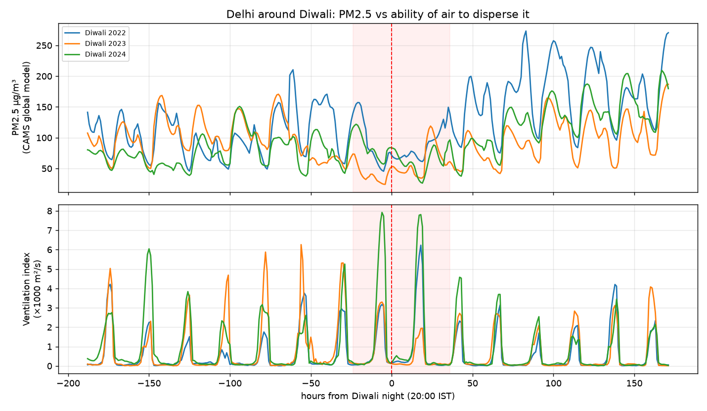

# NOₓ: Street-level Diwali air forecasts

> **Street-level Diwali air forecasts that tell you why, and what to do.**
> *nox* (Latin) = night · NOₓ = nitrogen oxides

**Team Crimson:** Devansh Chaudhary (Lead) · Hardik Dhawan · Vijul Goyal · Himanshu
**Problem statement:** AI-Powered Neighborhood-Level Air Pollution Prediction System (Parayavaran Welfare Society × rootaccess)

---

## The idea

NOx is an AI web platform that forecasts air pollution **72 hours ahead for every ~0.7 km² neighborhood** around Diwali. It explains **what is causing it**, and turns the forecast into **clear actions** for citizens, officials and NGOs.

| Step | What it does |
|---|---|
| **Predict** | Hourly PM2.5/AQI forecast per neighborhood, with a low–high range and the cause split (crackers / stubble / trapped air / traffic) |
| **Plan** | GRAP-stage forecast, "Breathing Budget" (headroom to *Severe*) and a hotspot ranking for sprinklers and patrols |
| **Protect** | Risk = pollution × vulnerable population, which drives Hindi/Punjabi alerts to schools, ASHA workers and NGOs |

**Why it matters**
- PM2.5 rose **16×** on Diwali night in Delhi (IIT Delhi study)
- Only **6** continuous monitors cover all of Punjab
- Global forecast models (CAMS) show **no** Diwali spike (our analysis below)

*We don't cancel Diwali. We make it breathable.*

---

## Architecture

```mermaid
flowchart LR
  subgraph S[01 · Sources]
    A1[CPCB / OpenAQ<br/>PM2.5 · PM10]
    A2[Open-Meteo ERA5<br/>wind · BLH · T · RH]
    A3[CAMS<br/>global AQ prior]
    A4[NASA FIRMS<br/>farm fires]
    A5[OSM + WorldPop<br/>roads · land use · population]
  end
  subgraph F[02 · Ingest & Features]
    B1[Ingestion workers<br/>Python · hourly] --> B2[(Raw lake<br/>Parquet)] --> B3[Feature pipeline<br/>H3 · lags · Diwali clock] --> B4[(Feature store)]
  end
  subgraph M[03 · AI Core]
    C1[Baseline model B<br/>LightGBM · air w/o Diwali]
    C2[Diwali-excess model E<br/>LightGBM · cracker effect]
    C3[Quantile head<br/>P10 / P50 / P90]
    C4[Spatial downscaler<br/>regression kriging → H3]
    C5[Explainer<br/>SHAP cause split]
    C1 & C2 --> C3 --> C4
    C1 & C2 --> C5
  end
  subgraph D[04 · Decision Engine]
    D1[GRAP forecaster]
    D2[Breathing budget]
    D3[Hotspot ranker]
    D4[Risk scorer]
  end
  subgraph V[05 · Serving & Clients]
    E1[(PostGIS + Redis)] --> E2[FastAPI]
    E2 --> E3[Citizen web app<br/>React · MapLibre]
    E2 --> E4[Officer console]
    E2 --> E5[WhatsApp / SMS alerts]
  end
  S --> B1
  B4 --> M
  C4 & C5 --> D --> E1
  VAL[Validation<br/>LOSO-CV · held-out Diwali · AirDelhi] -.-> M
```



**Core ideas**
- **Two-part model:** `PM̂ = B(weather, fires, traffic) + E(Diwali, ventilation)`. The baseline learns normal air, and the excess model isolates the cracker spike.
- **Spatial downscaling:** `Z(s) = f(area features) + kriged station residuals` gives a value for every H3 hexagon, even unmonitored ones.
- **Key signals:** ventilation index `VI = wind × boundary-layer height`, hours from Diwali (lunar calendar), lagged farm fires × north-west wind.
- **Validation:** leave-one-station-out CV, a held-out Diwali season, and a street-level check against AirDelhi bus sensors (Diwali 2020). The model must beat persistence and CAMS.

**Tech stack:** Python · pandas · LightGBM · SHAP · PyKrige · H3 · FastAPI · PostGIS · Redis · React · MapLibre GL · Docker

---

## Early evidence (real data)



- **CAMS (global, ~40 km) shows no Diwali-night spike** in 2022–2024. Coarse models can't see firecracker emissions.
- **The ventilation index drops to ~0 every night**, so crackers burst exactly when the air can't disperse them.

---

## Repo structure

```
ml/
  config.py          # Delhi bbox, H3 resolution, Diwali dates 2015–2026, stations
  aqi.py             # CPCB National AQI conversion
  ingest/            # weather.py, aq.py (CAMS + CPCB), fires.py (FIRMS), osm.py
  features/build.py  # time, Diwali, weather, fire-transport, lag features
  models/train.py    # LightGBM quantile models, baselines, leave-one-station-out CV
  eda_diwali.py      # generates the evidence chart
backend/app/         # FastAPI (/hexes /forecast /explain /scenario /advisory), mock predictions for now
frontend/            # React + Vite + MapLibre hex map dashboard
docs/                # architecture notes, images
```

## Run locally

```bash
# backend
python -m venv .venv && source .venv/bin/activate
pip install -r requirements.txt
uvicorn backend.app.main:app --reload        # http://127.0.0.1:8000/docs

# evidence chart (no API keys needed)
python -m ml.eda_diwali

# frontend
cd frontend && npm install && npm run dev     # http://localhost:5173
```

## Roadmap

| Round | Goal | Status |
|---|---|---|
| 1 | Idea, architecture, repo skeleton, live data ingestion | ✅ |
| 2 | Train models on CPCB data, real predictions in the app, pitch deck | ⏳ |
| 3 | Diwali 2026 forecast, alerts, end-to-end demo | ⏳ |
