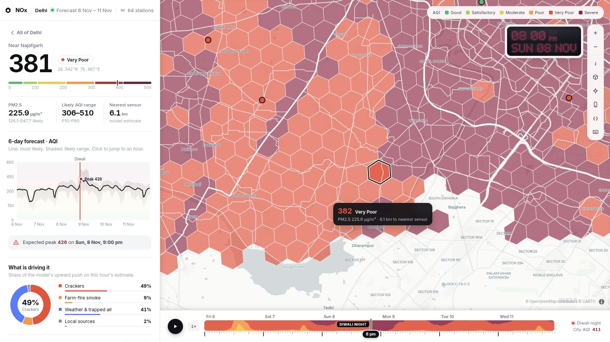
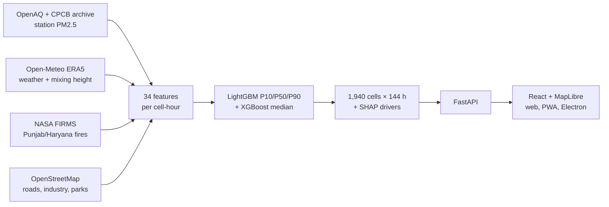

<div align="center">

# NOₓ

### Street-level air-quality forecasts for Diwali, including places with no air monitor

**🏆 Winner: CodeAccess Overnight Hackathon, Thapar Institute of Engineering and Technology**


<sub>Diwali night, 8 Nov 2026, 8 PM. Each column is one ~0.7 km² hexagon, and its height and colour are the model's forecast AQI. The circles are real government monitors.</sub>

</div>

---

## Why this exists

Delhi relies on about **60 government air monitors** (CPCB / DPCC / IMD) for **~1,430 km²** of city. A monitor measures the air very accurately, but **only at the spot where it stands**:

- **66%** of Delhi is more than 2 km from the nearest monitor, **28%** is more than 4 km away, and the farthest point is 10.4 km away.
- For those areas, the only option today is to read the number from the nearest monitor, which may be on a different road, near different traffic, or downwind of a different source.
- Monitors only report **now**. They can't tell a family that the air in their area will turn *Severe* at 9 PM on Diwali night.

Outside the big cities, in most towns and almost all villages, there is no monitor at all.

**NOₓ estimates PM2.5 and AQI for every ~0.7 km² hexagon in Delhi, hourly, up to 6 days ahead.** It works from conditions that exist everywhere: weather, how well the air can disperse, smoke from farm fires upwind, the Diwali clock and local land use. Because it doesn't need a sensor in an area to forecast that area, the same method can extend to places that have never had a monitor.

### NOₓ vs. relying on government monitors

| | Government monitors | NOₓ |
|---|---|---|
| Coverage | ~60 points | **1,940 hexagons**, all of Delhi |
| Areas > 2 km from a monitor | Copy the nearest reading | Own estimate for every cell |
| Time | Current reading only | **Hourly forecast, 144 h ahead** |
| Uncertainty | none given | Low / likely / high range per cell |
| Explains *why* | No | Crackers vs farm-fire smoke vs weather vs local sources |
| Alerts | No | Push alerts per area, English and Hindi |

We tested the "copy the nearest monitor" approach directly: each real monitor was hidden in turn and predicted, once by NOₓ and once by copying its nearest neighbour. **NOₓ was closer to the real reading**, even though the copy method gets to see the real same-hour value from the neighbour, which a forecast never can. It also clearly beats CAMS, the global atmospheric model from Copernicus/ECMWF.

<p align="center"><br/><sub>Average error (µg/m³) when a real monitor is hidden and predicted. Lower is better.</sub></p>

---

## Every number on screen comes from the model

Nothing on screen is hardcoded, demo or mock data. Every value is either **model output** or a **real measurement**:

| On screen | Where it comes from |
|---|---|
| Hexagon colours, 3D heights, AQI, PM2.5 | The model's P50 forecast for that cell and hour (`predictions.parquet`) |
| Low–high range | The model's P10 / P90 quantile forecasts |
| City average, worst areas, share by category | Computed live from the 1,940 cell forecasts |
| Crackers / farm-fire / weather / local breakdown | SHAP contributions from the model for that cell-hour |
| Distance to nearest sensor | H3 cell centre to real monitor coordinates |
| Circles on the map | **Real** latest readings from OpenAQ. Click one to check it on the public site |
| Accuracy charts | The evaluation run in `ml/train.py` / `ml/proof.py` (`metrics.json`, `proof.json`) |

If the model hasn't been built, the API returns `503` and the site shows a build-progress screen, because there is no fallback data. You can check any value yourself:

- `GET /api/model/live?h3=<cell>&t=<hour>` rebuilds the 34 inputs on the server, runs the models live (in tens of milliseconds) and reports whether the result matches the stored forecast.
- `./nox verify` re-runs 200 random cell-hours, checks the SHA-256 fingerprints of every model file and compares against fresh OpenAQ readings.

---

## Screens

### City view (2D)

The sidebar shows the city-wide average, the worst area, how much of the city is *Very Poor* or worse, a 6-day outlook with the range of all areas shaded, and the worst-hit localities. The timeline at the bottom scrubs through all 144 hours (<kbd>D</kbd> jumps to Diwali night, <kbd>3</kbd> toggles 3D).

### One area: what's driving it

This cell near Najafgarh is **6.1 km from the nearest monitor**. The panel shows its own AQI, its likely range, a 6-day forecast and the expected peak. The donut chart splits the model's estimate into **Crackers 49% · Weather & trapped air 41% · Farm-fire smoke 9% · Local sources 2%**. These shares come from the model's SHAP attributions for this hour.

### Replaying a Diwali the model never saw
<p align="center"></p>

For this replay the model was retrained **without the 2025 season** and then asked to forecast it. **Black** is what real sensors measured, **blue** is the model, and the shaded band is its range. It follows the daily cycle and the Diwali build-up from conditions alone. The sharpest Diwali-night spike comes out lower than measured, so the app labels Diwali-night peaks as a minimum, not a maximum.

---

## How it works



- **Training data:** 836,036 hourly readings from 101 stations over 12 post-monsoon seasons (2015–2026).
- **Features:** hours from Diwali night, weather, **ventilation** (wind × boundary-layer height, i.e. how well pollution can disperse), farm-fire counts lagged 1–3 days crossed with north-west wind, land use per hexagon, and the historical profile of nearby monitors. **No live sensor reading is used to forecast**, which is why it works anywhere on the grid.
- **Model:** three LightGBM quantile models give the low / likely / high range. The middle estimate is blended in log space with an XGBoost model, using weights tuned on stations held out from training. In total there are 1,600 trees, trained on a laptop CPU.
- **Why:** TreeSHAP contributions are grouped into the four causes shown in the app.
- **Serving:** FastAPI serves both the API and the site. The frontend uses MapLibre GL for the hexagons and 3D extrusion, plus a mobile PWA with Web Push alerts and an Electron desktop build.

---

## Run it

Needs Python 3.12, Node 20.19+, and two free API keys: [OpenAQ](https://explore.openaq.org/account) · [NASA FIRMS](https://firms.modaps.eosdis.nasa.gov/api/map_key/)

```bash
./nox setup     # once: installs everything, asks for the two keys
./nox run       # opens http://localhost:8000 (the built model is in the repo, so this takes seconds)
```

`./nox forecast` gets the latest weather and re-forecasts · `./nox refresh` downloads new data and retrains · `./nox verify` runs the integrity check · `./nox desktop` opens the Electron app.

---

## Scope

- **Delhi (NCT) only.** It's the test bed because it has enough real monitors to check against. Circles shown in Ghaziabad, Noida or Gurugram are real monitor readings, not forecasts.
- Forecasts PM2.5. The AQI shown is the hourly PM2.5 AQI, not the official 24-hour multi-pollutant AQI.
- Traffic isn't measured directly; road density stands in for it.
- Future farm-fire counts are assumed to continue at the last week's level.

```
ml/          ingest/ (data downloaders) · features.py · train.py · predict.py · proof.py · verify.py
backend/     FastAPI app, live inference, push alerts
frontend/    React + MapLibre dashboard and mobile app
electron/    desktop shell
```

<div align="center"><sub>Data: OpenAQ · CPCB (via Kaggle) · Open-Meteo / ERA5 · NASA FIRMS · © OpenStreetMap contributors · © CARTO</sub></div>
