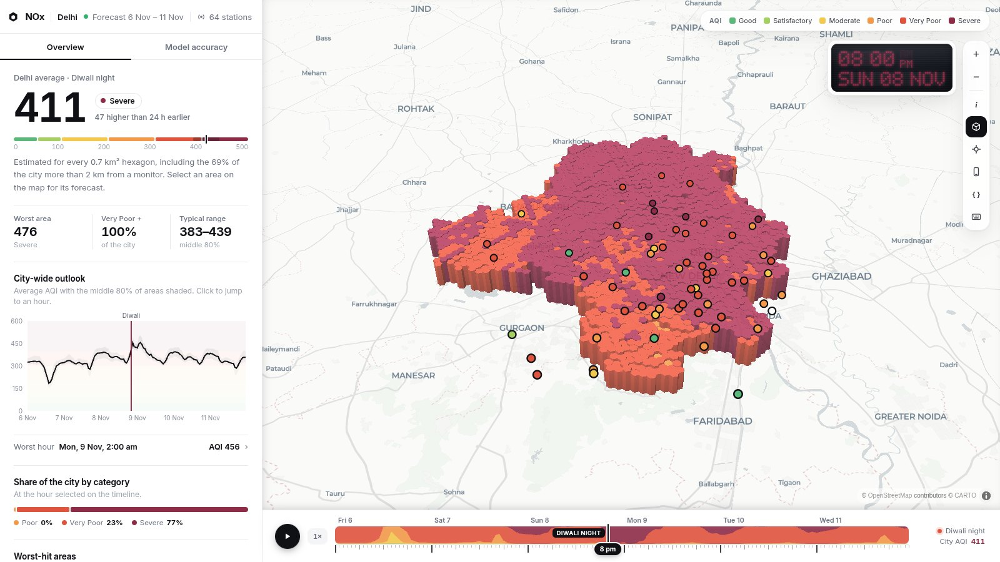
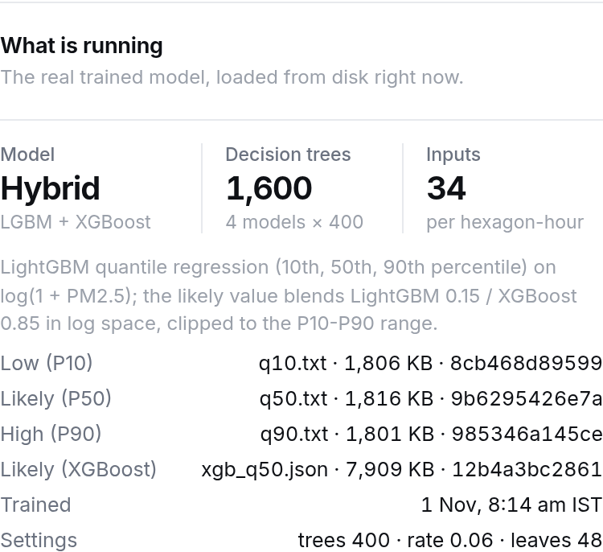
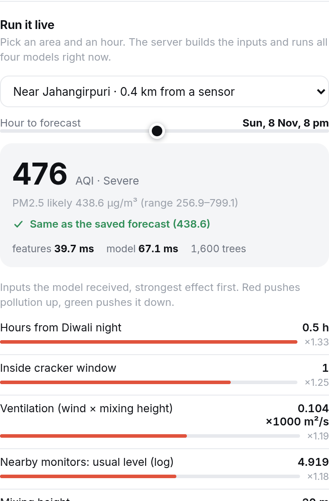
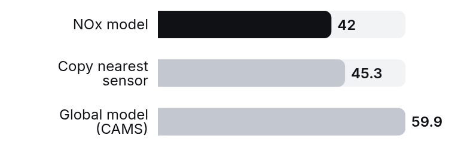
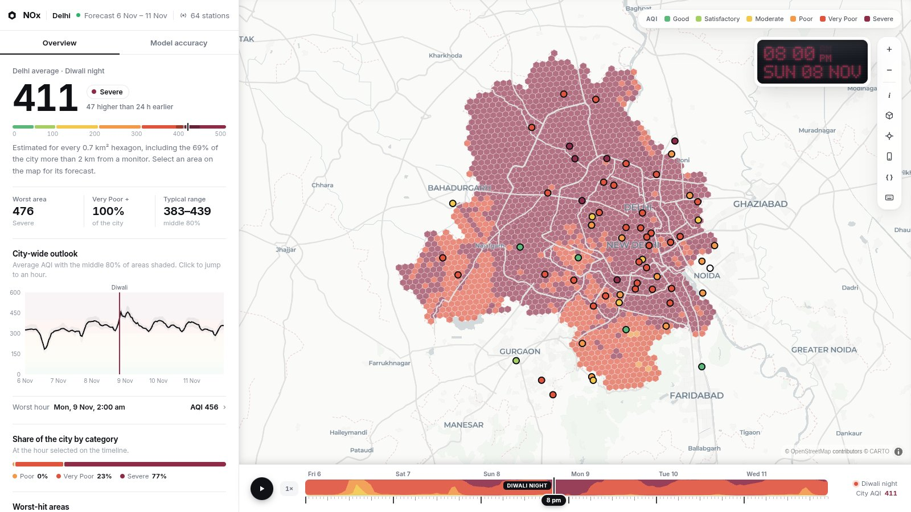
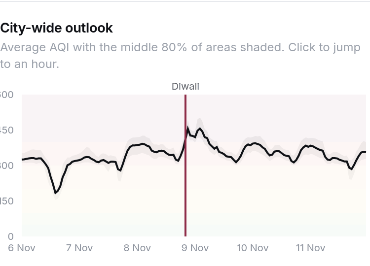
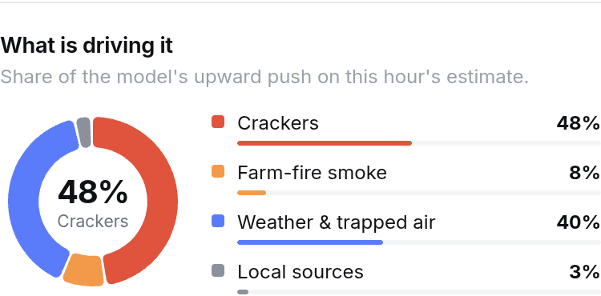
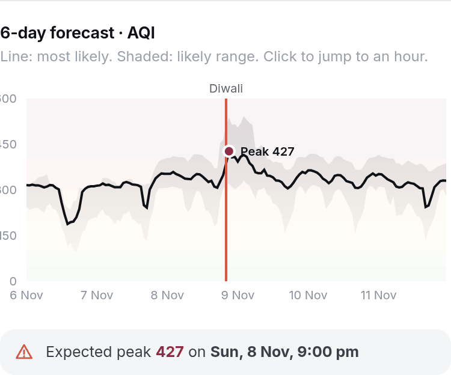
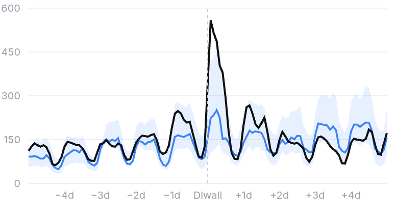
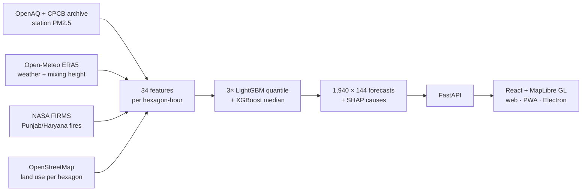

<div align="center">

# NOₓ

### A hybrid LightGBM + XGBoost ensemble that forecasts hourly PM2.5 for every 0.7 km² of Delhi, with no sensor needed in the cell

**🏆 Winner: CodeAccess Overnight Hackathon, Thapar Institute of Engineering and Technology**




<sub>Diwali night, 8 Nov 2026, 8 PM. Each column is one H3 hexagon, and its height and colour are the model's forecast AQI. The circles are real government monitors.</sub>

</div>

**In one line:** NOₓ divides Delhi into **1,940 hexagons** and forecasts the PM2.5 level (and the AQI) in each one, **hour by hour for 6 days around Diwali**. It does this from weather, how well the air can disperse, smoke from farm fires upwind, the time relative to Diwali night and local land use. It does not copy a nearby sensor, so it also works where there is no monitor. For every hexagon it also says **how sure it is** and **what is causing the pollution**.

---

## The model

Four gradient-boosted tree models, trained on **836,036 hourly readings from 101 monitoring stations over 12 seasons (2015–2026)**:

```
                       ┌──────────────────────────────┐
                       │ LightGBM quantile  (α = 0.10)│──▶ Low   (P10)
 34 inputs per    ───▶ │ LightGBM quantile  (α = 0.50)│──┐
 hexagon-hour          │ LightGBM quantile  (α = 0.90)│──┼──▶ High (P90)
                       └──────────────────────────────┘  │
                       ┌──────────────────────────────┐  │  blend in log space
                  ───▶ │ XGBoost  (L1 / median)       │──┴──▶ 0.15 · LightGBM + 0.85 · XGBoost
                       └──────────────────────────────┘          │
                                                     clip into [P10, P90] ──▶ Likely (P50)
```

- **Quantile regression.** The three LightGBM models are trained on different percentiles, so each forecast comes as a **range** (low / likely / high), not just a single number.
- **Hybrid median.** An XGBoost model is blended with the LightGBM median. The blend weight (0.15 / 0.85) was chosen automatically by testing on **monitoring stations held out of training**, so the blend is tuned for places the model hasn't seen. The result is clipped into the P10–P90 band so the range always stays consistent.
- **Log target.** Training uses `log(1 + PM2.5)` because Diwali-night spikes are several times the normal level and would otherwise dominate the training loss.
- **Explainable.** TreeSHAP splits each prediction into contributions from every input. These are grouped into four causes: **Crackers, Farm-fire smoke, Weather & trapped air, Local sources**.
- **Cheap to run.** 1,600 trees in total. A single forecast takes milliseconds on a laptop CPU, with no GPU and no cloud.

### The 34 inputs

| Group | Inputs |
|---|---|
| **Diwali clock** | Hours from Diwali night (clipped −72 h … +120 h so the model can't memorise individual years), cracker-window flag |
| **Weather** | Temperature, humidity, wind speed and direction, rain, surface pressure, **boundary-layer (mixing) height** |
| **Dispersion** | **Ventilation index** = wind speed × mixing height. Low values mean pollution is trapped near the ground |
| **Farm-fire smoke** | NASA satellite fire counts in Punjab and Haryana, lagged 1–3 days, crossed with north-west wind (the direction that carries the smoke to Delhi) |
| **Land use** | Road length and density, industrial / green / residential share, schools, hospitals, markets, all from OpenStreetMap for each hexagon |
| **Neighbourhood prior** | Distance to the nearest monitor and the *historical* average and Diwali rise of the 3 nearest monitors |
| **Time & place** | Hour of day (cyclic encoding), day of week, latitude / longitude |

**No live sensor reading is used to forecast.** That is why the model works for every hexagon, including the ones far from any monitor.

<table>
<tr>
<td width="50%"><br/><sub><b>Model card, served live by the backend.</b> The four model files with their sizes and SHA-256 hashes, the tree count and the blend.</sub></td>
<td width="50%"><br/><sub><b>Live inference.</b> The server builds the 34 inputs for the chosen hexagon and hour, runs all four models, shows how much each input pushed the value up or down, and confirms the result <b>matches the saved forecast</b>.</sub></td>
</tr>
</table>

---

## Why it's needed: ~60 monitors for 1,430 km²

Delhi has about **60 government air monitors** (CPCB / DPCC / IMD). Each one is accurate, but **only for the spot where it stands**:

- **66%** of Delhi is more than 2 km from the nearest monitor, **28%** is more than 4 km away, and the farthest point is **10.4 km** away.
- For those areas, the only option today is to use the nearest monitor's reading, which may be on a different road, near different traffic, or downwind of a different source.
- Monitors only report **the current hour**. They can't warn anyone that the air in their area will turn *Severe* at 9 PM on Diwali night.

| | Government monitors | NOₓ |
|---|---|---|
| Coverage | ~60 points | **1,940 hexagons**, all of Delhi |
| Areas far from a monitor | Use the nearest reading | A separate estimate for every hexagon |
| Time | Current reading only | **Hourly forecast, 144 hours ahead** |
| Uncertainty | none given | P10–P90 range for every hexagon |
| Cause of pollution | Not given | Crackers / farm-fire smoke / weather / local sources |
| Alerts | None | Push alerts per area, English and Hindi |

**Tested head-to-head.** Each real monitor was hidden in turn, then predicted two ways: by NOₓ and by copying the nearest monitor. **NOₓ was closer to the real reading**, even though the copy method gets the neighbour's actual same-hour value, which no forecast can have. It also clearly beats **CAMS**, the global atmospheric model from Copernicus / ECMWF.

<p align="center"><br/><sub>Average error (µg/m³) when a real monitor is hidden and predicted. Lower is better.</sub></p>

---

## Every number on screen is model output

There is no hardcoded, demo or mock data anywhere in the app:

| On screen | Source |
|---|---|
| Hexagon colours, 3D column heights, AQI, PM2.5 | The hybrid P50 forecast for that hexagon and hour |
| Low–high range | The P10 / P90 quantile models |
| City average, worst areas, share by category | Aggregated live from the 1,940 hexagon forecasts |
| Crackers / farm-fire / weather / local breakdown | TreeSHAP attributions for that hexagon and hour |
| Circles on the map | **Real** monitor readings from OpenAQ. Click one to check it on the public site |

If the model hasn't been built, the API returns `503` and the site shows a build-progress screen, because there is nothing to fall back on. Anyone can check this: `/api/model/live` re-runs the models for any hexagon and hour, and `./nox verify` re-runs 200 random hexagon-hours, checks every model file's SHA-256 and compares the latest readings with OpenAQ.

---

## What the app shows

### City view


<table>
<tr>
<td width="50%"><br/><sub><b>City-wide outlook.</b> Average AQI across all 1,940 hexagons for 144 hours. The shaded band covers the middle 80% of areas.</sub></td>
<td width="50%"><br/><sub><b>What is driving it.</b> SHAP contributions for one hexagon on Diwali night, grouped into the four causes.</sub></td>
</tr>
<tr>
<td width="50%"><br/><sub><b>One hexagon, 6 days.</b> The line is the hybrid P50 and the shading is the P10–P90 range, with the expected peak hour flagged.</sub></td>
<td width="50%"><br/><sub><b>Replay of a Diwali the model never saw.</b> The model was retrained <i>without</i> the 2025 season and then forecast it. Black is real sensors, blue is the model. It follows the daily cycle and the Diwali build-up from conditions alone. The sharpest spike comes out lower than measured, so the app treats Diwali-night peaks as a minimum.</sub></td>
</tr>
</table>

Other features: a 144-hour timeline (<kbd>D</kbd> jumps to Diwali night, <kbd>3</kbd> toggles 3D), an API console (<kbd>A</kbd>), a mobile web app with Web Push alerts in English and Hindi, and an Electron desktop build.

---

## Pipeline



The same feature builder is used for training, batch forecasting and live inference, so the inputs can't drift between them. A full forecast is 279,360 hexagon-hours.

---

## Run it

Needs Python 3.12, Node 20.19+, and two free API keys: [OpenAQ](https://explore.openaq.org/account) · [NASA FIRMS](https://firms.modaps.eosdis.nasa.gov/api/map_key/)

```bash
./nox setup     # once: installs everything, asks for the two keys
./nox run       # opens http://localhost:8000 (the trained model is in the repo, so this takes seconds)
```

`./nox forecast` gets the latest weather and re-forecasts · `./nox refresh` downloads new data and retrains · `./nox verify` runs the integrity checks · `./nox desktop` opens the desktop app.

## Scope

- **Delhi (NCT) only**, because it has enough real monitors to test against. Circles in Ghaziabad, Noida or Gurugram are real monitor readings, not forecasts.
- Forecasts PM2.5. The AQI shown is the hourly PM2.5 AQI, not the official 24-hour multi-pollutant AQI.
- Traffic isn't measured directly; road density stands in for it. Future farm-fire counts are assumed to continue at the last week's level.

```
ml/          ingest/ · features.py · train.py · predict.py · proof.py · verify.py
backend/     FastAPI app, live inference, push alerts
frontend/    React + MapLibre dashboard and mobile app
electron/    desktop shell
```

<div align="center"><sub>Data: OpenAQ · CPCB (via Kaggle) · Open-Meteo / ERA5 · NASA FIRMS · © OpenStreetMap contributors · © CARTO</sub></div>
